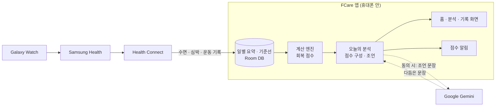
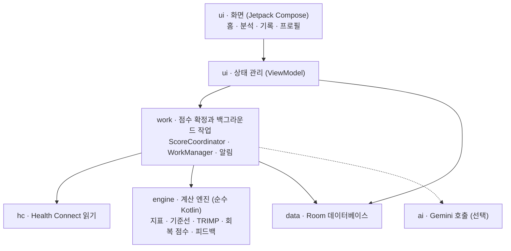

# FCare (퍼케어)

> 피로(Fatigue) + 케어(Care) — 갤럭시 워치의 수면·심박·운동 기록으로 매일 아침 **회복 점수**를 알려 주는 안드로이드 앱

2026 창의설계 2 · **Triple** 팀


[](https://github.com/KYU-SW/Triple/actions/workflows/android-ci.yml)
[](https://github.com/KYU-SW/Triple/actions/workflows/android-ci.yml)
[](https://github.com/KYU-SW/Triple/actions/workflows/android-ci.yml)

> 시험·커버리지 배지는 GitHub Actions가 `main`에 반영될 때마다 단위시험을 직접 실행해 갱신합니다. 실행 기록과 보고서는 [Actions](https://github.com/KYU-SW/Triple/actions/workflows/android-ci.yml)에서 볼 수 있습니다.

---

## 목차

1. [프로젝트 소개](#프로젝트-소개)
2. [주요 기능](#주요-기능)
3. [사용하는 데이터](#사용하는-데이터)
4. [회복 점수 계산 (요약)](#회복-점수-계산-요약)
5. [근거와 데이터 출처](#근거와-데이터-출처)
6. [유사 서비스와 차별점](#유사-서비스와-차별점)
7. [데이터 흐름과 앱 구조](#데이터-흐름과-앱-구조)
8. [기술 스택](#기술-스택)
9. [시험과 검증](#시험과-검증)
10. [빌드와 실행](#빌드와-실행)
11. [진행 현황](#진행-현황)
12. [팀원별 기여](#팀원별-기여)
13. [폴더 구성](#폴더-구성)

## 프로젝트 소개

갤럭시 워치가 기록한 수면, 수면 중 최저 심박, 운동 부하를 **나의 평소 상태(개인 기준선)** 와 비교해
0~100점의 **회복 점수**(높을수록 몸이 가벼움)를 계산합니다.
사용자가 입력하는 것은 처음 한 번의 프로필뿐이고, 나머지는 워치 데이터로 자동으로 처리합니다.

- **타깃 사용자**: 평소 운동하는 일반인
- **개발 기간**: 2026.09 ~ 2026.12
- **진행 방식**: 폭포수(Waterfall) 모델 — 제안 → 분석 → 설계 → 구현 → 시험

> FCare는 의료기기가 아니며, 회복 점수와 조언은 진단을 대신하지 않습니다.

## 주요 기능

| 기능 | 설명 |
| --- | --- |
| 회복 점수 | 어젯밤 수면 기록이 들어오면 자동으로 계산해 하루 1번 확정. 4단계 등급(피로함 / 보통 / 편안함 / 가벼움)과 안내 문구 표시. 12:00까지 수면 기록이 없으면 그날은 "데이터 부족"으로 두고, 가장 최근 점수를 "어제까지의 점수"로 표시 |
| 오늘의 분석 | 평소(60점)보다 점수가 오르내린 이유를 항목별로 표시하고 감점 합계를 보여 줌. 오늘의 조언(최대 3개)과 활동 추천 제공 |
| AI 문장 다듬기 (선택) | 사용자가 동의한 경우에만 조언 문장을 Google Gemini로 자연스럽게 다듬음. 점수·등급과 "평소 대비" 조언 문장만 보내고, 실패하면 앱에 들어 있는 규칙 문장 표시 |
| 점수 알림 | 앱이 꺼져 있을 때 점수가 확정되면 점수·조언 한 줄·오늘의 추천 활동을 알림으로 보냄 |
| 기록 | 회복 점수(등급 구간 띠)·수면·최저 심박·운동 부하 그래프와 평소 범위, 그래프 자세히 보기, 주간·월간 요약, 날짜별 조회 |
| 프로필·설정 | 프로필 수정, Health Connect 권한 재설정, 알림·AI 설정, 기록 내보내기(CSV), 용어 설명, 데이터 초기화 |

### 화면 구성

시작 → 최초 설정(프로필) → Health Connect 권한 요청 → 하단 탭 **홈 / 분석 / 기록 / 프로필**

<!-- 화면 캡처: docs/images/에 screen_home.png, screen_feedback.png, screen_history.png, screen_profile.png를 넣은 뒤 아래 주석을 풀면 표시됩니다.
| 홈 | 분석 | 기록 | 프로필 |
| :---: | :---: | :---: | :---: |
|  |  |  |  |
-->

## 사용하는 데이터

| 데이터 | 출처 | 회복 점수에서의 쓰임 |
| --- | --- | --- |
| 수면 | Health Connect 수면 기록 | 총 수면 시간, 수면 효율, 수면 규칙성(잠든·깬 시각이 평소와 다른 정도) |
| 수면 중 최저 심박 | Health Connect 심박 기록 | 평소보다 높으면 회복이 덜 된 신호. 심박변이도(HRV)는 Samsung Health가 Health Connect로 넘기지 않아 대신 사용 |
| 운동 부하 | Health Connect 운동 기록 + 운동 중 심박 | 운동마다 TRIMP를 계산하고, 최근 7일 부하(ATL)와 평소 28일 부하(CTL)의 비율(ACWR)로 평가 |
| 프로필 | 사용자 입력 | 나이·성별 → TRIMP 계산, 평소 운동 빈도 → 처음 운동 부하 기준 추정 |

건강 데이터는 **휴대폰 안에만 저장**하며 별도 서버가 없습니다.

## 회복 점수 계산 (요약)

1. 각 지표를 개인 기준선(최근 28일)과 비교해 점수로 바꿉니다. 처음 7일은 일반 기준값을 섞어 쓰고 "기준선 쌓는 중"으로 표시합니다.
2. 세 축을 가중 평균해 회복 지수 R을 구합니다. 값이 없는 축은 남은 축끼리 가중치를 다시 나눕니다.
   - **수면 0.40** (총 수면 시간 0.50 · 규칙성 0.25 · 효율 0.25)
   - **수면 중 최저 심박 0.30**
   - **운동 부하 0.30**
3. **회복 점수 = 60 + 25 × R** (0~100으로 제한). 평소와 같은 날은 60점입니다.
4. 다음 경우에는 점수를 **49점 이하로 제한**하고 이유를 보여 줍니다.
   - C1: 수면 중 최저 심박이 평소보다 크게(2표준편차 이상, 5bpm 이상) 높음
   - C2: 최근 운동 부하가 평소의 1.5배 이상 (워치 착용 14일 이후부터 적용)
   - C3: 수면이 평소보다 크게 부족하거나 5시간 미만
5. 최근 3일 평균 수면이 6시간보다 적으면, 부족한 1시간마다 수면 시간 점수를 1씩 깎습니다.

| 점수 | 0~25 | 25~50 | 50~75 | 75~100 |
| --- | --- | --- | --- | --- |
| 등급 | 피로함 | 보통 | 편안함 | 가벼움 |

모든 가중치·기준값은 [`Params.kt`](src/FCare/app/src/main/java/com/triple/fcare/engine/Params.kt) 한 파일에 모여 있고, 계산 예시는 `docs/3_설계`의 상세설계서에 있습니다.

## 근거와 데이터 출처

### 계산식의 근거

수면·심박·운동 부하를 합친 점수의 가중치를 결과로 도출한 연구는 없고, 상용 서비스도 모두 가중치를 공개하지 않습니다. 그래서 FCare는 **"동일 가중에서 출발해 근거 강도만큼 소폭 보정"** 하는 방법론을 따르고, 모든 값을 공개 상수로 두었습니다. 전체 문헌표와 실측 점검은 [회복 점수 근거 조사 보고서](docs/참고자료/FCare%20회복%20점수%20근거%20조사%20보고서.md)에 있습니다.

| 설계 결정 | 근거 |
| --- | --- |
| 동일 가중에서 출발 | 결과 데이터가 없을 때 동일 가중이 회귀 가중치만큼 잘 작동 (Dawes 1979; Wainer 1976; Graefe 2015) |
| 수면 축 0.40 (가장 큼) | 급성 수면 부족 시 운동 수행 −7.56%, 69편 메타분석 (Craven et al. 2022, *Sports Medicine*) |
| 개인 28일 기준선 | 일률 기준보다 개인화 권고 (Walsh et al. 2021, *BJSM* 전문가 합의), Polar·Firstbeat 28일 창 |
| 수면 규칙성 별도 지표 | 수면 규칙성은 수면 시간과 독립적인 건강 지표 (Phillips 2017; Windred 2024) |
| 최저 심박 가점 상한 +0.5 | 과도훈련에서 안정시 심박이 오히려 내려감 (Le Meur 2013), 심박 급상승은 신뢰할 만한 이상 신호 (Mishra 2020) |
| 운동 부하 TRIMP | Banister TRIMP (Morton, Fitz-Clarke & Banister 1990), 세션 RPE와 r 0.50~0.85 (Impellizzeri 2004) |
| 부하 비율 EWMA·분모 하한 | EWMA가 이동평균보다 민감 (Williams 2017; Griffin 2020 체계적 고찰), 비율 폭주 대응 (Lolli 2019; Impellizzeri 2020) |
| 최소 수면 6시간 | 성인 7시간 이상 권고 (Watson 2015), 6시간은 "적절할 수 있음" (Hirshkowitz 2015), 누적 수면 부족 (Van Dongen 2003) |
| 점수 상한 49점 | 한 지표의 심각한 이상을 다른 지표가 상쇄하지 않도록 하는 설계값 (C1 Mishra 2020, C2 Gabbett 2016, C3 Craven 2022) |

### 데이터 출처

| 구분 | 내용 |
| --- | --- |
| 앱이 읽는 데이터 | Galaxy Watch → Samsung Health → **Health Connect** (수면·심박·운동·걸음 수, 읽기 전용) |
| 시험에 쓴 실측 데이터 | 팀원 1명(20대 남성, 주 3~ 4회 운동)의 Galaxy S23 + Galaxy Watch, **2026-11-06 ~ 11-24 (19일)**. 수면 17밤, 운동 30회, 수면 중 심박 1분 간격·운동 중 1 ~2초 간격 |
| 공개 범위 | 원자료는 개인 건강 정보라 저장소에 올리지 않고, 날짜·점수·요약값만 익명으로 [통합시험 결과서](docs/5_시험)와 근거 조사 보고서에 실었습니다 |
| 타당성 검증 상태 | 계산 정확성(독립 재계산 차이 0.000점)·가중치 민감도(등급 일치 88.9%)는 확인. 점수와 실제 피로감의 관계(저녁 자기평가 상관)는 자료를 모으지 못해 **아직 검증하지 않음** |

> FCare는 의료기기가 아니며 임상적 효용을 검증하지 않았습니다. 회복 점수는 생활 습관 참고용입니다.

## 유사 서비스와 차별점

| | **FCare** | 삼성 헬스 에너지 점수 | WHOOP Recovery | Oura Readiness | Garmin Body Battery | Fitbit Daily Readiness |
| --- | --- | --- | --- | --- | --- | --- |
| 추가 비용 | **없음** (가진 Galaxy Watch로 무료) | 없음 | 구독 | 링 + 구독 | 기기 구매 | Premium 구독 |
| 계산식·가중치 공개 | ✅ 전부 공개 | ❌ | ❌ | ❌ | ❌ | ❌ |
| 점수 이유를 숫자로 분해 | ✅ 지표별 ±점 | 요인 표시 | 요인 표시 | 요인 상태 | 그래프 | 요인 표시 |
| 운동 부하(TRIMP·ACWR) 직접 반영 | ✅ | 전날 활동 | 별도 점수(Strain) | 활동 균형 | 활동 소모 | — |
| 데이터 저장 | **기기 안에만** | 계정 동기화 | 클라우드 | 클라우드 | 클라우드 | 클라우드 |
| 검증 자료 공개 | ✅ CI 단위시험·통합시험 결과서 | — | — | — | — | — |

자세한 비교와 출처는 [유사 서비스 비교](docs/참고자료/FCare%20유사%20서비스%20비교.md)에 있습니다.

## 데이터 흐름과 앱 구조

### 데이터 흐름

건강 데이터는 휴대폰 안에서만 처리하고, 사용자가 동의한 경우에만 조언 문장(점수·등급·"평소 대비" 표현)을 Gemini로 보냅니다.



### 앱 구조



계산 엔진(`engine`)은 Android에 의존하지 않아 PC와 GitHub Actions에서 단위시험 31개로 확인합니다.

## 기술 스택

| 구분 | 내용 |
| --- | --- |
| 플랫폼 | Android 13 이상 (minSdk 33, targetSdk 36) |
| 언어 / UI | Kotlin 2.2, Jetpack Compose (Material 3) |
| 건강 데이터 | Health Connect (connect-client 1.1.0-alpha10) |
| 저장 | Room 2.7 (기기 안 저장, Android 자동 백업·CSV 내보내기) |
| 백그라운드 | WorkManager 2.10 (04:00~12:00 1시간 간격 확인, 12:00 마감) |
| AI (선택) | Google Gemini API (`gemini-2.5-flash`, 추가 라이브러리 없이 HTTPS 호출) |
| 시험 | JUnit 단위시험 31개 (계산 엔진 U-01 ~ 16, 피드백 U-17 ~ 22, 원자료 처리 U-23 ~ 31), JaCoCo 커버리지, GitHub Actions 자동 실행 |
| 협업 도구 | Microsoft Teams, Microsoft Project, GitHub |

## 시험과 검증

| 시험 | 방법 | 결과 |
| --- | --- | --- |
| 단위시험 | JUnit 31개, PR·`main` 반영마다 [GitHub Actions](https://github.com/KYU-SW/Triple/actions/workflows/android-ci.yml)가 자동 실행 | 위 배지 참고. 실행 요약(Summary)과 시험·커버리지 보고서(아티팩트)를 누구나 확인 가능 |
| 통합시험 | 팀원 실기기(Galaxy S23, Android 16 + Galaxy Watch)에서 19일 사용, Android 16 에뮬레이터 보조, 시험 항목 36개 | 통과 35 · 실패 1(AI 문장 다듬기) → 조건부 합격 |
| 계산 정확성 | 상세설계서 계산식을 Python으로 따로 구현해 앱 점수와 비교 | 10일 최대 차이 **0.000점**, 상한 일치 |
| 가중치 민감도 | 가중치를 무작위로 1,000번 바꿔 다시 계산 | 등급 일치 88.9%, 순위 상관 중앙값 0.851 |
| 성능 | 앱 실행 → 홈에 점수가 보일 때까지 10회 | 평균 2.13초 (기준 3초) |

자세한 내용은 `docs/5_시험`의 단위시험 결과서·통합시험 결과서에 있습니다.

## 빌드와 실행

**준비물**: Android Studio, JDK 17 이상(Android Studio 내장 JBR 사용 가능), Android 13 이상 휴대폰, Health Connect 앱(Android 14 이상은 내장), 데이터를 넣을 Galaxy Watch 또는 [Health Connect Toolbox](https://goo.gle/health-connect-toolbox)(시험용 기록을 직접 넣는 개발 도구)

1. Android Studio에서 `src/FCare` 폴더를 열고 Gradle Sync를 합니다.
2. (선택) AI 문장 다듬기를 쓰려면 `src/FCare/local.properties`에 아래 내용을 추가합니다. 이 파일은 `.gitignore` 대상이라 저장소에 올라가지 않습니다. **API 키를 코드나 커밋에 넣지 마세요.**
   ```
   gemini.apiKey=발급받은_키
   gemini.model=gemini-2.5-flash
   ```
3. Galaxy Watch → Samsung Health → Health Connect 연동이 켜진 Android 13 이상 휴대폰에서 실행합니다. Android 13은 Health Connect 앱을 따로 설치해야 합니다.
4. 단위시험은 `app/src/test/java/com/triple/fcare/engine/` 폴더를 오른쪽 클릭해 실행합니다 (`RecoveryEngineTest`, `FeedbackEngineTest`, `MetricsEngineTest`). 명령줄에서는 `src/FCare`에서 아래처럼 실행합니다.
   ```
   ./gradlew :app:testDebugUnitTest                                                   # 단위시험
   ./gradlew :app:testDebugUnitTest :app:createDebugUnitTestCoverageReport -Pcoverage  # 커버리지 포함 (Actions와 같은 명령)
   ```

기여 방법(브랜치·PR·커밋 규칙, 올리면 안 되는 파일)은 [CONTRIBUTING.md](CONTRIBUTING.md)에 있습니다.

## 진행 현황

| Phase | 단계 | 상태 | 산출물 |
| --- | ----- | --- | --- |
| 1 | 제안 | 완료 | 로고, 아키텍처, 초기개발 기획서 |
| 2 | 분석 | 완료 (재작업 반영) | 산출물관리기획서, 형상관리기획서, 요구사항 분석서, 요구사항 심사서, 위험관리계획서, 품질관리계획서 |
| 3 | 설계 | 완료 (정정 반영) | 기본설계서, 상세설계서 |
| 4 | 구현 | 완료 | 앱 전체 구현 (`src/FCare`), 소스코드 문서관리서 |
| 5 | 시험 | 완료 | 개요 및 테스트 전략, 단위시험 계획서·결과서(31개 통과), 통합시험 계획서·결과서(팀원 실기기 2026-11-06 ~ 11-24, 조건부 합격) |

_기준일: 2026-11-24_

## 팀원별 기여

<!-- 팀원별로 맡은 부분을 채워 주세요. GitHub 계정을 적으면 커밋 기록과 함께 확인할 수 있습니다. -->

| 이름 | GitHub 계정 | 맡은 부분 |
| --- | --- | --- |
|  |  |  |
|  |  |  |
|  |  |  |

## 폴더 구성

| 폴더 | 내용 |
| --- | --- |
| `docs/0_회의록` | 회의록 (회의마다 1개) |
| `docs/1_제안` | 초기개발 기획서 |
| `docs/2_분석` | 산출물관리기획서, 형상관리기획서, 요구사항 분석서, 요구사항 심사서, 위험관리계획서, 품질관리계획서 |
| `docs/3_설계` | 기본설계서, 상세설계서 |
| `docs/4_구현` | 소스코드 문서관리서 |
| `docs/5_시험` | 개요 및 테스트 전략, 단위시험 계획서·결과서, 통합시험 계획서·결과서 |
| `docs/참고자료` | 회복 점수 근거 조사 보고서, 유사 서비스 비교 |
| `src/FCare` | Android 앱 소스코드 |
| `.github` | GitHub Actions 자동 시험(`workflows/android-ci.yml`), 이슈 템플릿 |

변경 이력은 커밋 기록으로 확인.
